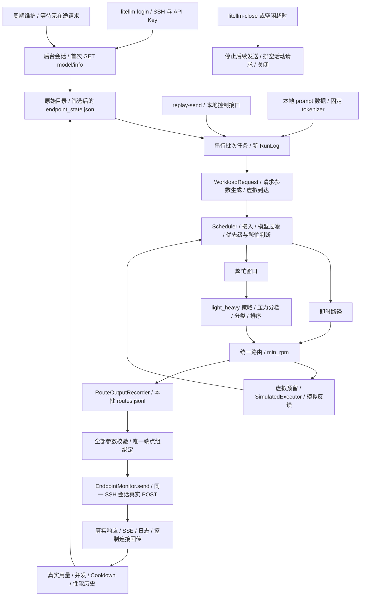

# 架构与数据流

[项目首页](../README.md) · [完整运行流程](../项目完整运行流程.md) · [开发接口](development.md)

## 外围会话与核心边界

统一 CLI 仅保留 litellm-login、replay-send、litellm-status、litellm-close。integrations/session_cli.py 负责生命周期命令，session_service.py 在后台持有登录隧道、EndpointMonitor 和串行批次任务，session_control.py 是受令牌保护的本机控制客户端。API Key 在后台内存中，匿名管道用于首次交接，不写入控制文件或进程参数。

litellm-login 先认证并获取部署目录，完成后返回终端。发送命令复用后台运行 replay_and_send，每批创建独立日志；全部完成或普通批次错误均保留后台。空闲超时或关闭命令停止后续发送，等待活动请求结束后释放维护模块及隧道。维护 GET 不延长空闲计时。

## 核心调度

core/request.py 定义 SchedulerRequest、RequestBatch、RouteDecision、ExecutionResult 和 SchedulingRecord。标准请求携带模型、Token 估计、messages、stream、SLO、metadata；模拟与核心均只使用 priority=0/1，1 为高优先级。缺少显式值时由 simulation/priority.py 按配置生成两级值，四档字段及排序适配已删除。

core/endpoint_filter.py 区分模型/接口/上下文兼容池、健康及 Cooldown 可用池、瞬时容量可派发池。core/busy_detector.py 对每个端点使用 RPM、TPM、并发任一达到软门槛即繁忙；目标模型可用池全部繁忙才进入系统繁忙路径。软繁忙不等于硬容量耗尽。

core/admission.py 选择路径：高优先级直接即时选择，可使用软繁忙阈值之后尚未耗尽的容量；低优先级非繁忙时仅选择非繁忙池，即时派发；繁忙时进入 core/batch_window.py，满批或截止后释放。policies/ranking.py 默认使低优先级窗口内轻请求在前、重请求在后，同类保持到达顺序。派发前重新读取候选与硬容量；窗口队首等待时后续窗口请求不越过队首，即时队列可继续检查其他可派发请求。

policies/ranking.py 注册独立策略 light_heavy，实现位于 policies/light_heavy_ranking.py。策略内部组合压力判断、门槛选择、轻重分类和排序，通过 rank_requests 返回 RankingResult；Scheduler 只提供当前状态上下文、校验和记录结果。即时请求使用策略的可选 classify_requests 接口记分类，不进入窗口排序。FIFO 与 weighted_length 不调用该分类模块，不加载历史参考。两类繁忙判定仍分开：接入的 RPM/TPM 软繁忙决定调度路径，策略内部的压力分档决定输出重门槛。

core/router.py 统一调用 policies/routing.py，默认 min_rpm。RouteDecision 与当前请求一起交给派发回调。core/endpoint_state.py 负责预留、滚动额度、并发释放、实际用量修正和恢复时刻；core/endpoint_history.py 维护近期性能。Scheduler 的虚拟循环由 simulation/engine.py 驱动。

## 两套实例与时间轴

真实 EndpointMonitor 和虚拟 Scheduler 使用同一 EndpointStateManager 算法的独立实例。模拟配置中的端点能力来自真实维护文件，虚拟调度仍从自己的虚拟初始状态开始，不继承真实 RPM/TPM 或真实历史。

simulation/execution.py 计算虚拟完成时间，使原有批次排程能够跑通。真实 POST 在整批模拟完成之后按路由文件顺序串行执行，反馈只更新 Monitor。必须保留虚拟状态实例与执行器，否则当前“先模拟路由再发送”流程无法释放并发、推进窗口或恢复额度。

真实额度跨批次保留；维护部署目录不会清零额度。刷新到期先关闭发送入口，排空本进程在途请求，再 GET 并更新文件。当前状态只反映本后台发送的请求，不代表其他客户端或 LiteLLM 全局负载。

静态模拟端点文件、离线命令、旧交互网关、兼容转发和旧图形快照已删除。固定百分位参考及 tokenizer 缓存仍被主线读取，逐请求日志与真实端点快照仍是有效输出。
