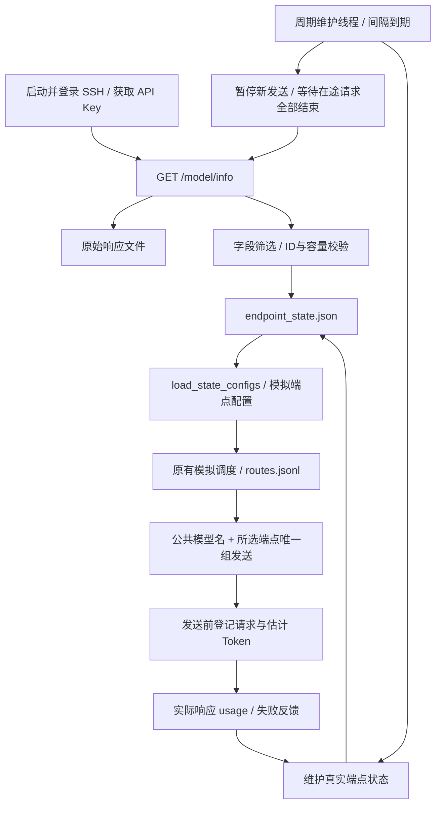

# LiteLLM 端点发现与状态维护

[项目首页](../README.md) · [运行与发送](litellm_gateway.md) · [开发接口](development.md)

真实 `replay-send` 以登录后读取的 LiteLLM 部署为端点来源。原始返回和筛选后的状态分别保存；原有路由、排序和模拟事件循环继续复用。离线 `replay`、`replay-send --dry-run` 没有远端登录，仍使用本地端点配置。

## 运行方式

正常模拟两条请求后发送，同时每 10 秒尝试更新一次端点目录和状态：

```powershell
& .\.venv\Scripts\python.exe -m workload_profiling replay-send `
  --limit 2 --ssh-target ubuntu@118.195.173.231 `
  --endpoint-update-interval 10
```

命令启动时登录一次；登录完成后使用相同 SSH 隧道和 API Key 执行 `GET /model/info`，对应用户提供的 curl 命令。首次获取或数据校验失败时终止，不使用旧模拟端点代替远端结果，不发送模型请求。

仅获取端点信息，不调用模型：

```powershell
& .\.venv\Scripts\python.exe -m workload_profiling endpoint-watch `
  --ssh-target ubuntu@118.195.173.231 --once
```

持续维护时去掉 `--once`：

```powershell
& .\.venv\Scripts\python.exe -m workload_profiling endpoint-watch `
  --ssh-target ubuntu@118.195.173.231 --endpoint-update-interval 10
```

该命令持续运行至 Ctrl+C，周期查询只读取部署信息。它自己的请求计数为零，因为没有发出模型请求；它不会扫描其他进程的日志或推断其他客户端的负载。不能和 replay-send 同时写同一状态目录，可用 `--endpoint-state-dir` 指定另一目录。

| 参数 | 含义 |
| --- | --- |
| `--endpoint-update-interval SECONDS` | 正数，允许小数，默认 30 秒；到期后暂停新发送，等在途请求结束再刷新 |
| `--endpoint-state-dir PATH` | 原始文件与状态文件的目录，默认 `workload_profiling/results/endpoints` |
| `--endpoint-rpm-limit N` | 显式覆盖所有发现端点的 RPM 上限 |
| `--endpoint-tpm-limit N` | 显式覆盖所有发现端点的 TPM 上限 |
| `--endpoint-concurrency-limit N` | 显式覆盖所有发现端点的并发上限 |

容量覆盖用于调用方已确认的本地控制值，在状态文件中标记 `local_override`；它不会修改远端 LiteLLM 的配置。未传覆盖时使用远端的有效值。并发上限需要大于调度配置中的 busy_concurrency_reserve，沿用已有阈值校验。

## 文件与筛选字段

```text
workload_profiling/results/endpoints/
  endpoint_catalog_raw.json    /model/info 完整响应结构，凭据脱敏
  endpoint_state.json          端点配置、当前观测状态和历史性能
```

原始文件保留 null 和未使用字段，供排查数据来源；API Key、密码等凭据字段不会原样落盘。状态文件只保存当前调度所需的配置和运行状态，配置字段可直接转换为现有 EndpointConfig。

| 来源 | 状态字段 | 处理 |
| --- | --- | --- |
| `model_info.id` | endpoint_id | 每个部署唯一标识；不能用公共模型名合并多个部署，不作为 HTTP model |
| `model_name` | supported_models、deployment_model | 目标模型匹配及网关公共模型名，例如 deepseek-flash |
| `litellm_params.model` | provider_model | 保留供应商模型名，便于排查 |
| `litellm_params.api_base` | api_base | 供应商服务地址 |
| `litellm_params.tags` | tags | 端点组匹配 |
| rpm、tpm、max_parallel_requests | rpm_limit、tpm_limit、concurrency_limit | 优先使用 litellm_params 的非 null 值，再读取 model_info；显式本地覆盖优先 |
| input/output_cost_per_token | input/output_price_per_million | 换算为每百万 token 价格 |
| max_input_tokens | context_limit | 作为保守的上下文长度保护上限；null 表示没有可用上限 |
| 实际发送及响应记录 | runtime、history | 请求数、Token、并发、失败、Cooldown、累计量和观测 E2E 等 |

用户提供的返回中有四个部署：official、relay、volc、ai360-cdtx，公共模型名均为 deepseek-flash。各部署在 litellm_params 中提供 RPM=60；model_info.rpm 的 null 不会覆盖该值。TPM、并发和上下文容量缺失时保留 null，表示未知，不能解释为 0、无限的真实容量或模拟配置的容量。

未知容量不参与该项硬容量或繁忙阈值判断，仍统计相应请求量；利用率为 null。默认 min_rpm 在 RPM 已知时保持原算法；RPM 未知时按观测请求数比较。动态输出分类依赖并发容量，候选中有未知并发上限时使用 NORMAL 映射，并将相关容量指标置为 null，不猜测空闲或满载。

api_types=chat 表示本项目当前接入的接口类型，不代表 model/info 已验证所有远端能力。

## 数据与时钟



`EndpointMonitor` 持有独立的真实 EndpointStateManager。真实状态以 Unix 毫秒维护 60 秒滚动窗口；模拟仍使用虚拟毫秒及模拟反馈。两条时间轴不混用，模拟派发不会计入真实 RPM/TPM。

发送前根据已生成的 SchedulerRequest 预留请求数、估计 Token 和并发，并立即更新文件。响应返回后使用实际 prompt_tokens/completion_tokens 修正预留，释放本地在途并发；usage 缺失时保留估计。流式响应从 SSE 的 usage 事件获取用量。429 和服务错误按现有调度配置维护 Cooldown，网络超时另记 uncertain_requests，因为客户端不能确认远端是否已执行完毕；不会自动补发。

周期刷新遵循以下顺序，手动调用 refresh() 也使用同一道同步门：

1. 间隔到期，立即暂停新请求的真实发送；新调用等待，不丢弃或自动重试。
2. 等待当前进程所有在途请求结束，要求 inflight 为空且所有端点并发为 0。完整流式响应尚未结束时也算在途；完成反馈继续执行，不受暂停影响。
3. 使用原登录会话拉取 /model/info，校验、筛选并更新文件。拉取期间继续暂停新发送。
4. 成功或失败后解除暂停。成功后发送时重新检查所选端点；失败保留最近一次有效目录，记录 last_refresh_error，再恢复发送。已移除端点不会被继续发送。

这里选择“没有请求正在运行”作为安全条件。RPM 是最近 60 秒的历史请求数：已完成请求仍占 RPM，而运行超过 60 秒的请求可能出现 RPM=0，因此不能用 RPM=0 代替在途检查。刷新不强制清零 RPM/TPM，也不额外等待历史 RPM 归零。

刷新保留同一 ID 的滚动窗口、历史和累计量；新增部署添加状态，移除部署标为不可用并保留历史。请求登记、反馈和快照读取也推进窗口，不必等周期刷新。没有请求时由周期维护清理到期项。维护间隔从上一次刷新尝试结束后重新等待，长请求或慢查询会延后实际拉取时间，期间不会堆积定时刷新任务。

endpoint_state.json 增加 refresh_pending 和 refresh_phase。后者为 idle（正常发送）、waiting_for_idle（暂停并等待在途完成）、refreshing（正在拉取及更新）。文件写入失败时也会释放同步门并报错，避免永远阻塞新请求。关闭 Monitor 时取消等待中的新发送及刷新，等已接收的请求结束后释放资源。

文件是状态快照，内存中的请求预留及反馈是运行期间的状态来源。写文件采用临时文件加原子替换，读者不会读取半份 JSON。目录内使用独占锁防止两个进程同时维护；正常退出移除锁。进程强制崩溃可能留下锁，确认旧进程已退出后才移除 `.endpoint_monitor.lock`。新进程不会将旧快照中的并发数伪造成可恢复的执行任务。

state_scope=this_process_requests、remote_global_load_known=false：状态只覆盖当前进程发送并收到反馈的请求。`/model/info` 是部署配置，不提供整个网关的实时 RPM/TPM、并发或健康；其他客户端的流量和服务端实际 Cooldown 不能由这个接口推算。接入网关全量日志时，需要另外扩展观测来源。

本次集成仍先模拟 N 条、再串行发送。真实响应更新新状态文件，不能改变已经结束的模拟调度。需要持续在线调度时可以复用同一个 Monitor 和现有 Scheduler，而不是把整次模拟误当作在线执行。

## 代码位置与在线接口

| 模块 | 职责 |
| --- | --- |
| [catalog.py](../workload_profiling/endpoint_monitor/catalog.py) | 字段筛选、容量来源、配置校验、从状态文件读取 EndpointConfig |
| [service.py](../workload_profiling/endpoint_monitor/service.py) | 首次与周期刷新、真实请求登记及反馈、原子状态文件、生命周期及互斥 |
| [cli.py](../workload_profiling/endpoint_monitor/cli.py) | endpoint-watch 独立入口 |
| [litellm_gateway.py](../workload_profiling/integrations/litellm_gateway.py) | 已登录会话的 get_model_info、公共模型及组参数、响应 model-id 头 |
| [replay_litellm.py](../workload_profiling/integrations/replay_litellm.py) | 登录后启动维护，模拟从新文件获取端点，真实发送交给 Monitor |
| [simulation/config.py](../workload_profiling/simulation/config.py) | 可注入发现配置；真实模式不读取旧 endpoint_config.json，仍读取调度和模拟服务时间设置 |

Scheduler 已有 state_manager 注入接口。在线调用方可将 monitor.states 注入 Scheduler：submit_request、tick 使用 monitor.scheduler_guard()，在刷新时等待；完成反馈使用 monitor.scheduler_guard(admission=False)，并调用 accept_feedback(result, drain=False)，只完成已运行请求，避免反馈顺带派发排队请求。刷新完成后在普通 guard 中调用 tick 推进等待队列。guard 退出会唤醒刷新等待者；按需调用 publish() 刷新快照。阻塞结束后进入 Scheduler 的请求 arrival_time 应取 monitor.now_ms()，避免旧时间戳导致时钟倒退；若需统计调度接入之前的等待时长，应在接入日志另存原到达时间。tick 也使用最新 monitor.now_ms()，且均为同一 Unix 毫秒时间轴。不要把真实管理器放进虚拟时钟 SimulationRunner。

Monitor.send 用于当前模拟后发送入口，会自行等待同步门、reserve 和 complete，不需要改主线调用方式。使用在线 Scheduler 时它已经预留请求，应直接执行网关调用并通过 Scheduler.accept_feedback 回传 ExecutionResult，不能再次调用 Monitor.send 重复预留。使用多个线程发送时仍须在上述 guard 内修改调度状态；不要在尚未完成的请求执行回调中同步调用 refresh()，它会等待该请求本身结束。

项目仍不引入 LiteLLM SDK，不修改远端部署。当前部署的 policy shell 按公共模型名查找候选；把 model_info.id 当作 HTTP model 的请求曾返回 HTTP 500（policy shell: no deployments available for ...）。因此 HTTP model 使用每条请求的 target_model，选定部署 ID 保留在路由与状态中。

Monitor.bind_payload 在当前目标模型的全部可用部署中寻找仅属于选中端点的 tag，将它写入 metadata.endpoint_group；例如选中 official 端点时发送 model=deepseek-flash、endpoint_group=[official]。该组也通过 route_adapter 写入 routes.jsonl，独立发送工具可以复用。--endpoint-group 仍可省略，没有固定默认值；显式传入时限定候选及可用 tag，最终绑定会缩窄到选中端点的唯一组。

若同一目标模型有多个部署但没有唯一 tag，发送前明确拒绝，避免把网关重新选出的部署算在原端点上。目标模型只有一个部署且没有 tag 时可仅按公共模型名发送。若响应提供 x-litellm-model-id，继续核对是否为选中的部署；不匹配时停止且不将 usage 错记。endpoint_group 是当前网关的部署约定，不假定所有原生 LiteLLM 服务均按此字段筛选；服务器仍需落实该约定。

HTTP 500 等错误会保留日志并终止后续发送，不自动改用其他端点或补发。修正参数后重新运行会重新模拟并发送，旧日志保留；旧部署 ID 直传且缺少组的交付记录要求重新生成。当前本地测试使用假网关，没有自动重发真实请求。
